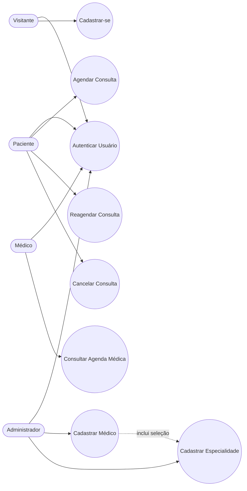

# Casos de Uso — MedFácil Mobile

## 1. Atores

| Ator | Descrição |
| :--- | :--- |
| **Visitante** | Usuário sem sessão; pode fazer login ou cadastro de paciente |
| **Paciente** (`PACIENTE`) | Agenda, reagenda e cancela as próprias consultas |
| **Médico** (`MEDICO`) | Consulta suas próximas consultas |
| **Administrador** (`ADMIN`) | Cadastra médicos e especialidades |
| **API MedFácil** (sistema externo) | Backend REST que valida regras, aplica RBAC e persiste dados |

---

## UC01 — Autenticar Usuário

| Item | Descrição |
| :--- | :--- |
| **Atores** | Visitante, Paciente, Médico, Administrador |
| **Requisitos** | RF01, RF02, RF03, RF04, RNF01, RNF02 |
| **Pré-condições** | App instalado; dispositivo com acesso à API; usuário cadastrado (para login) |
| **Pós-condição (sucesso)** | Token e usuário salvos em `expo-secure-store`; usuário na Home da sua role |

**Fluxo principal (login)**
1. O app inicia, lê a sessão no SecureStore (aguarda hidratação). Sem token, exibe Login.
2. O usuário informa CPF (máscara `000.000.000-00`) e senha.
3. O app valida CPF (algoritmo oficial) e senha obrigatória.
4. O app envia `POST /auth/login` com CPF só com dígitos.
5. A API devolve `{ token, user: { id, name, email, role } }`.
6. O app grava a sessão e redireciona: `PACIENTE` → Home do paciente; `MEDICO` → Home do médico; `ADMIN` → Home do admin.

**Fluxos alternativos**
- **A1 – Sessão existente:** no passo 1, se há token válido salvo, vai direto à Home da role.
- **A2 – Cadastro de paciente (RF04):** no Login, o visitante toca "Criar conta", preenche nome, e-mail, CPF, telefone, data de nascimento e senha (≥ 8); o app valida localmente e envia `POST /auth/register`; a API retorna `201` com token e o usuário entra logado como `PACIENTE`.
- **A3 – Logout (RF03):** o usuário toca "Sair"; o app chama `POST /auth/logout` (falha ignorada), limpa token, usuário e cache de consultas e volta ao Login.
- **A4 – Acesso a área de outra role:** o app redireciona para a Home da role do usuário.

**Fluxos de exceção**
- **E1 – CPF inválido/vazio ou senha vazia:** mensagem junto ao campo; nada é enviado.
- **E2 – Credenciais incorretas:** exibe a mensagem da API (ou "Erro ao fazer login").
- **E3 – Muitas tentativas:** o `loginLimiter` do backend bloqueia temporariamente; app exibe a mensagem retornada.
- **E4 – Cadastro duplicado (`409`):** "CPF ou e-mail já cadastrado."; dados preenchidos são mantidos.
- **E5 – Token expirado/inválido (`401`) em qualquer requisição:** o app limpa a sessão e leva ao Login.
- **E6 – Sem conexão/erro de servidor:** mensagem genérica e possibilidade de nova tentativa.

---

## UC02 — Agendar Consulta

| Item | Descrição |
| :--- | :--- |
| **Ator** | Paciente |
| **Requisitos** | RF05, RF06, RF07, RNF03, RNF06, RNF08 |
| **Pré-condições** | Paciente autenticado; existe ao menos uma especialidade com médico ativo e horários livres |
| **Pós-condição** | Agendamento criado (`CONSULTA`, status `AGENDADO`) e visível na Home e na lista de agendamentos |

**Fluxo principal**
1. Na Home ou em "Consultas", o paciente toca "Agendar consulta".
2. **Etapa 1 – Especialidade:** o app lista `GET /catalog/specialties`; o paciente escolhe uma.
3. **Etapa 2 – Profissional:** o app lista `GET /catalog/specialties/:id/doctors` (nome e CRM); o paciente escolhe um.
4. **Etapa 3 – Data:** o app mostra os próximos 14 dias (a partir de hoje, fuso `America/Recife`); o paciente escolhe um dia.
5. **Etapa 4 – Horário:** o app consulta `GET /catalog/doctors/:id/slots?date=AAAA-MM-DD` e exibe os horários `HH:mm` livres; o paciente escolhe um.
6. O app exibe o resumo (especialidade, médico, data, horário) para revisão.
7. O paciente confirma; o app envia `POST /appointments { doctorId, date, time }`.
8. A API cria o agendamento (transação com trava do horário) e responde `201 { appointment }`.
9. O app atualiza o cache (`upsert`) e leva o paciente ao acompanhamento de agendamentos.

**Fluxos alternativos**
- **A1 – Voltar/alterar escolha:** ao mudar uma etapa anterior, as etapas seguintes são reiniciadas.
- **A2 – Sem horários no dia:** exibe "sem horários"; o paciente escolhe outra data.
- **A3 – Etapa bloqueada:** etapas futuras ficam desabilitadas até concluir a anterior.

**Fluxos de exceção**
- **E1 – Horário ocupado (`409` "Este horário não está mais disponível."):** informa, recarrega horários e pede nova escolha.
- **E2 – Paciente já tem consulta no horário (`409`):** informa o conflito e mantém a revisão.
- **E3 – Médico inexistente/inativo (`404`):** informa e retorna à etapa de profissional.
- **E4 – Falha ao carregar listas:** mensagem com "Tentar novamente".
- **E5 – `401`:** UC01 E5.

---

## UC03 — Reagendar / Cancelar Consulta

| Item | Descrição |
| :--- | :--- |
| **Ator** | Paciente |
| **Requisitos** | RF07, RF08, RF09 |
| **Pré-condições** | Paciente autenticado; possui consulta futura com status `AGENDADO` ou `CONFIRMADO` |
| **Pós-condição** | Reagendar: nova data/horário, mesmo médico, status `AGENDADO`. Cancelar: status `CANCELADO`, consulta some da lista e da Home |

**Fluxo principal A – Reagendar**
1. Em "Agendamentos", o paciente toca "Reagendar" na consulta.
2. O app abre o fluxo em modo reagendamento (sem etapas de especialidade e profissional; médico fixo).
3. O paciente escolhe data (14 dias) e horário livre do mesmo médico.
4. Revisa o resumo e confirma.
5. O app envia `PATCH /appointments/:id/reschedule { date, time }`; a API atualiza e responde `{ appointment }`.
6. O app atualiza o cache e exibe a consulta com o novo horário e status "Agendado".

**Fluxo principal B – Cancelar**
1. O paciente toca "Cancelar".
2. O app pergunta "Deseja realmente cancelar esta consulta?" com "Voltar" e "Confirmar".
3. Ao confirmar, envia `PATCH /appointments/:id/cancel`.
4. A API marca `CANCELADO`; o app remove a consulta do cache (lista e Home).

**Fluxos alternativos**
- **A1 – Desistir do cancelamento:** "Voltar" fecha a confirmação sem requisição.
- **A2 – Consulta não encontrada no cache ao reagendar:** o app recarrega a lista; se ainda inexistente, mostra erro com retorno à lista.

**Fluxos de exceção**
- **E1 – Consulta não pertence ao paciente / inexistente (`404`):** "Agendamento não encontrado."
- **E2 – Já cancelada (`409`):** "Este agendamento já foi cancelado."; app atualiza a lista.
- **E3 – Já iniciada/passada (`409`):** "Este agendamento não pode mais ser alterado."
- **E4 – Novo horário indisponível ou conflito com outra consulta (`409`):** orienta escolher outro horário.
- **E5 – Falha de rede:** mensagem "Não foi possível cancelar. Tente novamente."; botões reabilitados.

---

## UC04 — Consultar Agenda Médica

| Item | Descrição |
| :--- | :--- |
| **Ator** | Médico |
| **Requisitos** | RF10 |
| **Pré-condições** | Médico autenticado (`role = MEDICO`) |
| **Pós-condição** | Lista de próximas consultas exibida e agrupada por dia |

**Fluxo principal**
1. O médico abre a Home.
2. O app envia `GET /doctor/appointments?limit=N`.
3. A API retorna consultas ativas ordenadas por data (inclui em espera/em atendimento nas últimas 12 h).
4. O app mostra saudação "Dr(a). Nome" e a data de hoje.
5. Destaca o "Próximo paciente" (nome, horário, motivo).
6. Agrupa por dia (fuso da clínica) com títulos "Hoje · …", "Amanhã · …" ou data longa; cada item mostra horário, paciente, motivo (ou "Consulta") e status (Agendada, Confirmada, Em espera, Em atendimento, Finalizado).

**Fluxos alternativos**
- **A1 – Sem consultas:** "Você não tem consultas agendadas no momento."
- **A2 – Atualizar:** pull-to-refresh/"Tentar novamente" repete a requisição.
- **A3 – Período maior:** ampliar `limit` (período por intervalo de datas depende de evolução da API).

**Fluxos de exceção**
- **E1 – Falha ao carregar:** mensagem "Não foi possível carregar suas consultas." com "Tentar novamente".
- **E2 – `403`:** usuário sem role médica volta à sua Home.
- **E3 – `401`:** UC01 E5.

---

## UC05 — Cadastrar Médico / Especialidade

| Item | Descrição |
| :--- | :--- |
| **Ator** | Administrador |
| **Requisitos** | RF11, RF12 |
| **Pré-condições** | Admin autenticado (`role = ADMIN`); para cadastrar médico, ≥ 1 especialidade existente |
| **Pós-condição** | Médico (`role = MEDICO` com CRM e especialidades) e/ou especialidade criados; ações auditadas no backend |

**Fluxo principal A – Cadastrar Especialidade**
1. Na Home do admin, toca "Especialidades" (abre modal).
2. O app lista `GET /admin/specialties` (ordem alfabética).
3. O admin informa nome (3–80) e descrição opcional (≤ 200) e toca "Adicionar".
4. O app envia `POST /admin/specialties`; a API responde `201 { specialty }`.
5. A nova especialidade aparece na lista com o selo "Nova"; a Home exibe confirmação temporária; o formulário é limpo para nova inclusão.

**Fluxo principal B – Cadastrar Médico**
1. O admin toca "Criar médico".
2. Informa nome, e-mail, CPF, telefone (DDD), CRM (máscara `12345/PE`), senha inicial (8–72) e seleciona ≥ 1 especialidade.
3. O app valida localmente e envia `POST /admin/doctors` (CPF e telefone só com dígitos, `specialtyIds`).
4. A API cria usuário, médico e vínculos de forma atômica e responde `201 { doctor }`.
5. O app confirma o cadastro com nome do médico criado.

**Fluxos alternativos**
- **A1 – Especialidade inexistente na lista:** o admin abre o modal (fluxo A) a partir do formulário de médico e retorna com a nova opção.
- **A2 – Cadastrar outro médico:** formulário é limpo após o sucesso.

**Fluxos de exceção**
- **E1 – Nome de especialidade duplicado (`409`):** erro no campo nome ("Esta especialidade já existe.").
- **E2 – CPF/e-mail/CRM duplicado (`409`):** mensagem da API ("CPF já cadastrado.", "E-mail já cadastrado.", "CRM já cadastrado.").
- **E3 – CRM fora do formato / CPF inválido / senha curta / sem especialidade:** validação local por campo.
- **E4 – Especialidade removida (`400`):** "Alguma especialidade selecionada não existe mais."; recarrega a lista.
- **E5 – `403`:** acesso negado a não administradores.
